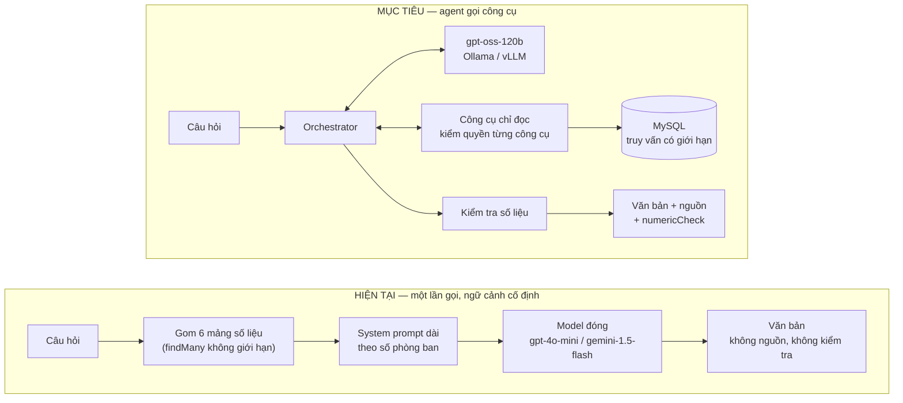
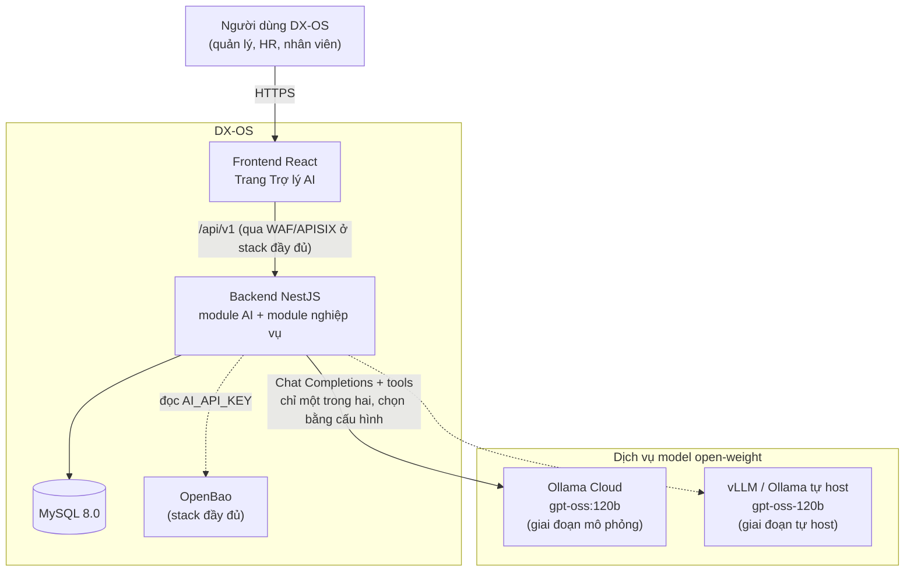
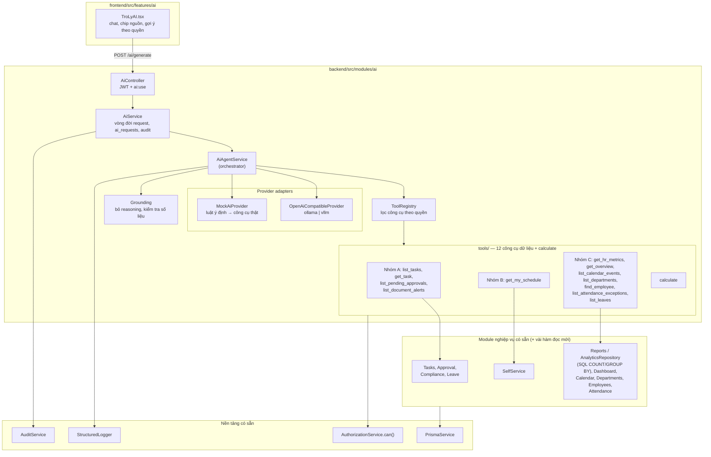
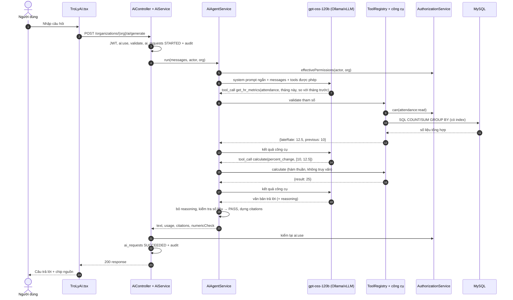
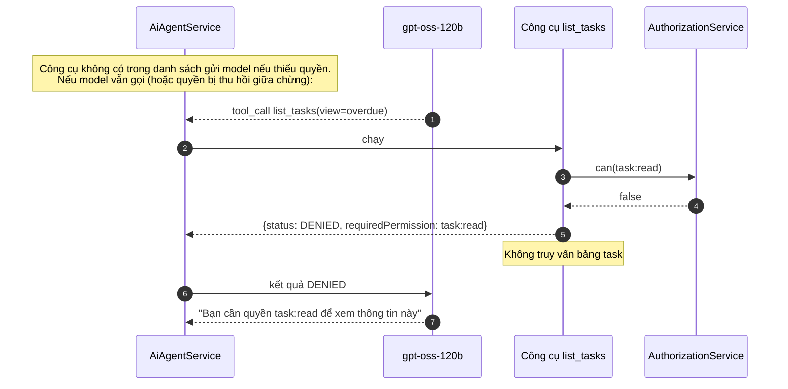
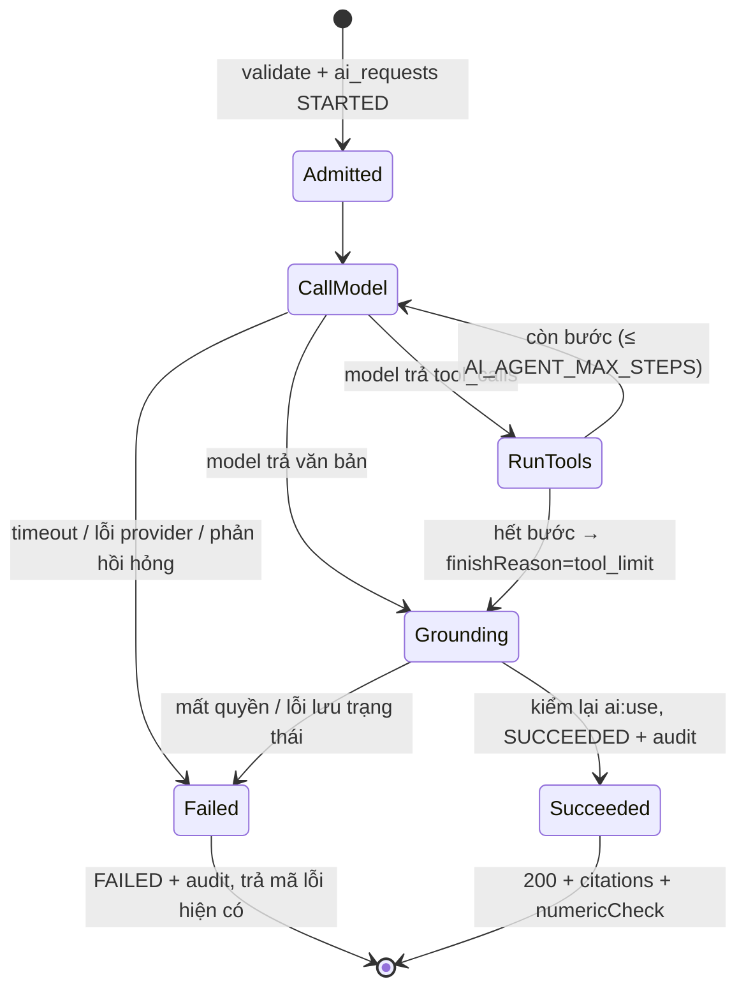
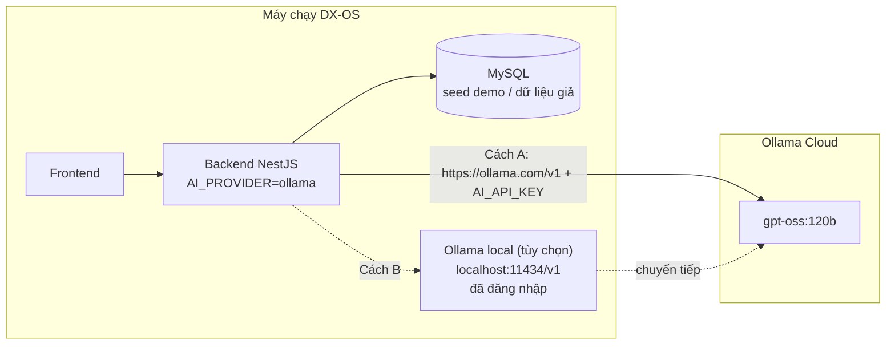
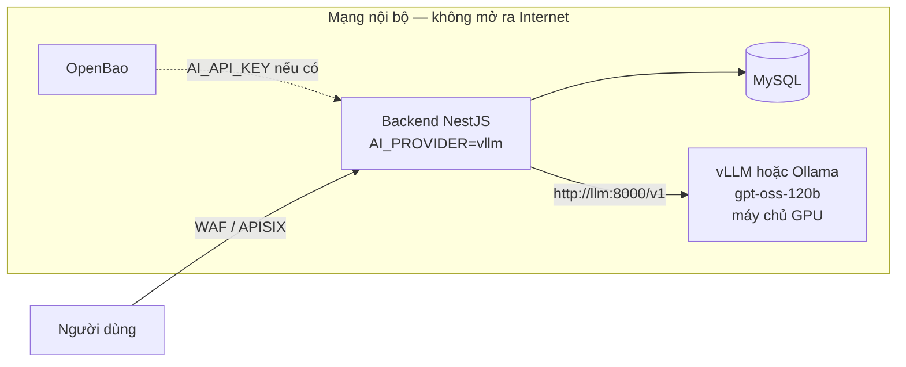
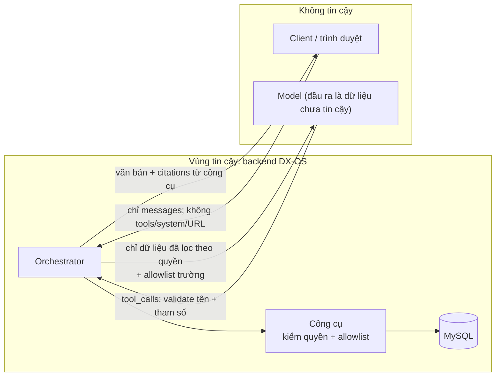
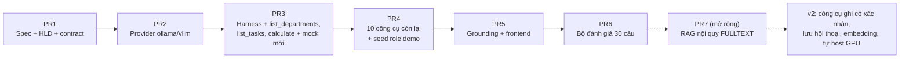

# High-Level Design: Agent hỏi đáp chỉ đọc trên model open-weight (DXOS-AI-003)

**Bổ sung 26/10/2026:** cấu hình role demo phải theo [ma trận nghiệp vụ hiện tại](demo-business-permissions.md), thay cho nhóm employee/manager/HR rộng của thiết kế ban đầu. Eval chạy được trên MySQL disposable và kiểm cả trường hợp 403, không nới quyền trên database người dùng. Numeric PASS không xác minh đúng ngữ nghĩa của câu trả lời.

| Mục | Giá trị |
| --- | --- |
| Tài liệu | High-Level Design (HLD) — phiên bản 0.3, 25/10/2026 (khớp spec v0.4) |
| Trạng thái | Implementation ở PR #23; hardening trên nhánh `fix/ai-agent-hardening`. CI/merge được xác nhận riêng trên GitHub |
| Owner | Khánh |
| Spec chi tiết | [ai-agent-v1-spec.md](ai-agent-v1-spec.md) (user stories, acceptance criteria, schema công cụ, cấu hình) |
| Liên quan | [ai-foundation.md](ai-foundation.md), [contracts/api/ai.md](../../contracts/api/ai.md), [rbac.md](rbac.md) |

## 1. Tóm tắt

Trợ lý AI hiện tại gửi **một khối số liệu tổng hợp cố định + câu hỏi** tới model **một lần**. Repo không có agent harness. Thiết kế này thay bằng một **agent hỏi đáp chỉ đọc**:

- Model **open-weight `gpt-oss-120b`**, phục vụ qua **Ollama** (giai đoạn mô phỏng) hoặc **vLLM/Ollama tự host** (khi có hạ tầng), qua một adapter tương thích OpenAI.
- Model **tự chọn trong 12 công cụ dữ liệu chỉ đọc + `calculate`**; backend **lọc công cụ theo quyền**, **kiểm quyền lại khi chạy**, chạy truy vấn có giới hạn, **tính toán bằng code**, rồi trả dữ liệu thật kèm **nguồn** và kết quả **kiểm tra số liệu**.
- Harness **tự viết** trong NestJS, không dùng LangChain/LangGraph, không thêm dependency.
- Mọi ranh giới hiện có được giữ: JWT, membership ACTIVE, `ai:use`, tách tổ chức, audit, giới hạn đầu vào/đầu ra. Không migration, không quyền mới, không lưu nội dung chat.

## 2. Hiện trạng và mục tiêu

| Vấn đề hiện tại | Hướng giải quyết trong thiết kế |
| --- | --- |
| Câu nào cũng chạy hết 6 mảng | Model chỉ gọi công cụ cần thiết; câu chào không gọi công cụ |
| Đọc dòng thô lên Node | Công cụ dùng `take` + projection; số liệu tổng hợp bằng SQL (`AnalyticsRepository`) |
| Lặp lại mỗi tin nhắn | Chỉ chạy công cụ được yêu cầu; cache Valkey là bước sau |
| Prompt dài theo số phòng ban | System prompt ngắn, không nhồi số liệu; ngân sách ký tự cho kết quả công cụ |
| Hallucination | Dữ liệu từ công cụ, `calculate` làm toán, nguồn chỉ từ công cụ, kiểm tra số liệu |
| Không trả lời được câu cấp bản ghi | Công cụ liệt kê bản ghi có ID làm link |
| Model private weight, URL viết cứng | `gpt-oss-120b` qua adapter cấu hình được `AI_BASE_URL` |

## 3. Ngữ cảnh hệ thống

Backend là thành phần **duy nhất** nói chuyện với dịch vụ model. Frontend không bao giờ gọi model trực tiếp và không biết địa chỉ hay key của model.

## 4. Kiến trúc thành phần

| Thành phần | Trách nhiệm | Mới / sửa / giữ |
| --- | --- | --- |
| `AiController` | Endpoint, guard JWT + `ai:use` | Giữ |
| `AiService` | Validate đầu vào, ghi `ai_requests`, audit, kiểm lại quyền trước khi trả | Sửa: gọi `AiAgentService` thay cho `invoke()` một lần |
| `AiAgentService` | Vòng lặp agent, ngân sách bước/thời gian/ngữ cảnh, điều kiện dừng, log từng bước | **Mới** |
| `ToolRegistry` + `tools/*` | Khai báo công cụ (tên, mô tả, schema, quyền, handler); lọc theo `effectivePermissions`; chạy công cụ có kiểm quyền | **Mới** |
| Hàm đọc trong module nghiệp vụ | Task quá hạn / của tôi, tìm nhân viên theo tên, đơn nghỉ theo khoảng ngày, lọc tài liệu SENSITIVE, lọc chấm công theo phòng ban; export service của reports/dashboard/calendar | **Thêm** (chỉ đọc, không đổi API cũ) |
| `seed-demo-roles.ts` | Role Nhân viên / Quản lý / HR cho 4 nhân viên demo để chứng minh phân quyền | **Mới** (script local/demo) |
| `Grounding` | Bỏ phần suy luận của model; kiểm tra số liệu; dựng `citations` | **Mới** |
| `OpenAiCompatibleProvider` | Chat Completions + `tools`/`tool_calls` cho Ollama và vLLM; `AI_BASE_URL` cấu hình | **Mới** |
| `MockAiProvider` | Luật ý định gọi công cụ thật, không văn mẫu bịa | Viết lại |
| `AiDataService` / `AiAnalyticsService` | Khối số liệu cố định | Không gọi cho mọi request; logic chuyển dần sang `get_hr_metrics` |
| `OpenAiProvider` / `GeminiAiProvider` | Model private weight | Không dùng (quyết định gỡ: spec Q4) |
| Module nghiệp vụ, RBAC, audit, logger | Nguồn dữ liệu và quy tắc phân quyền | Giữ, dùng lại |

## 5. Luồng xử lý

### 5.1 Happy path: câu hỏi cần số liệu và phép tính

Ví dụ: *"Tỷ lệ đi muộn tháng này tăng bao nhiêu so với tháng trước?"*

### 5.2 Luồng thiếu quyền

### 5.3 Vòng đời một request trong orchestrator

Mỗi công cụ trong `RunTools` tự trả `OK`, `EMPTY`, `DENIED`, `INVALID_ARGUMENTS` hoặc `UNAVAILABLE` cho model. Lỗi của một công cụ không làm hỏng cả request.

## 6. Kiến trúc agent harness

| Lớp harness | Cơ chế | Giá trị mặc định |
| --- | --- | --- |
| Danh mục công cụ | Registry khai báo tĩnh; chỉ gửi model công cụ người hỏi có quyền (`effectivePermissions`) | 12 công cụ dữ liệu + `calculate` |
| Điều phối | Vòng lặp model → công cụ → model; bước cuối không gửi `tools` để buộc trả lời | Tối đa 3 bước, 3 lời gọi/bước |
| Guardrails đầu vào công cụ | Tên trong registry; tham số qua class-validator; không nhận `organizationId`/`userId`/URL; thời gian dạng từ khóa (`period`) | Từ chối trường lạ |
| Guardrails phân quyền | `AuthorizationService.can()` trong transaction của từng công cụ | Luôn kiểm lại khi chạy |
| Guardrails đầu ra công cụ | Allowlist trường; không SĐT/email/GPS/lý do nghỉ/lương cá nhân; mặc định 10 bản ghi (trần 20) + `total` + `moreHref` | ≤ 6.000 ký tự/công cụ, ≤ 18.000 ký tự/request |
| Quản lý ngữ cảnh / bộ nhớ | System prompt ngắn; lịch sử 8 tin gần nhất do client gửi; dữ liệu lâu dài đọc qua công cụ; không lưu chat phía server; bỏ reasoning khỏi lịch sử | — |
| Ngân sách thời gian | Timeout mỗi lần gọi model + timeout tổng | 30 s / 45 s |
| Grounding | Nguồn chỉ từ kết quả công cụ; kiểm tra số liệu (cảnh báo, không chặn) | `numericCheck` PASS/WARN/NOT_APPLICABLE |
| Observability | Log `ai_agent_step`, `ai_tool_invoked`, `ai_numeric_check`, `ai_agent_completed` | Không log nội dung |
| Evaluation | Bộ 30 câu (`ai:eval`), chạy với mock và gpt-oss-120b qua `AiService` thật | gpt-oss 30/30, mock 20/20; kết quả vào `security-artifacts/` |

## 7. Danh mục công cụ (tóm tắt)

| Nhóm | Công cụ | Mục đích | Quyền | Nguồn dữ liệu |
| --- | --- | --- | --- | --- |
| A. Tôi cần làm gì | `list_tasks` | Task quá hạn / của tôi / sắp đến hạn, có ID làm link | `task:read` | Hàm đọc mới trong module Work |
| | `get_task` | Chi tiết một task (checklist, 3 bình luận gần nhất) | `task:read` | `TasksService` + collaboration |
| | `list_pending_approvals` | Đơn chờ duyệt theo phạm vi người hỏi | `approval:read` | `ApprovalService.list` |
| | `list_document_alerts` | Giấy tờ sắp/đã hết hạn, nhân viên thiếu hồ sơ; lọc SENSITIVE | `document:read` (+ `document:sensitive:read`) | Hàm đọc mới trong `ComplianceService` |
| B. Của tôi | `get_my_schedule` | Ca, chấm công, đơn nghỉ của chính người hỏi | `ai:use` | `SelfServiceService` |
| C. Công ty | `get_hr_metrics` | Chỉ số tổng hợp theo loại báo cáo và khoảng thời gian | `report:read` + quyền theo loại | `ReportsService` → `AnalyticsRepository` (SQL) |
| | `get_overview` | Tình hình chung | Từng phần theo quyền | `DashboardService` |
| | `list_calendar_events` | Họp, sự kiện, hạn task, ngày nghỉ | `calendar:read` | `CalendarService` |
| | `list_departments` | Danh sách phòng ban, số người, task mở | `department:read` | `DepartmentsService` |
| | `find_employee` | Tìm nhân viên theo tên (không dấu) để lấy ID | `employee:read` | Hàm đọc mới trong module People |
| | `list_attendance_exceptions` | Ai đi trễ / vắng / chưa check-out | `attendance:read` + `attendance:manage` | `AttendanceService` + lọc phòng ban |
| | `list_leaves` | Ai nghỉ trong khoảng ngày | `leave:read` (không có quyền duyệt: chỉ của mình) | Hàm đọc mới trong module Leave |
| Phụ trợ | `calculate` | Tỷ lệ, chênh lệch, % thay đổi, điểm phần trăm, trung bình | `ai:use` | Hàm thuần `Prisma.Decimal`, không `eval` |
| *Mở rộng* | `search_policies` | Tra nội quy, quy chế (RAG FULLTEXT) | `ai:use` | 2 bảng mới, PR 7, chỉ khi kịp |

Schema tham số và dữ liệu trả về chi tiết: spec mục 9.3.

## 8. Kiến trúc triển khai

### 8.1 Giai đoạn mô phỏng (không có GPU)

Prompt và kết quả công cụ **rời khỏi máy** tới hạ tầng Ollama. Giai đoạn này **chỉ dùng seed demo hoặc dữ liệu giả**.

### 8.2 Giai đoạn tự host

Chuyển từ 8.1 sang 8.2 **chỉ đổi cấu hình** (`AI_PROVIDER`, `AI_BASE_URL`, `AI_MODEL`, `AI_API_KEY`), không sửa code. Dịch vụ model đặt trong mạng nội bộ của Docker/hạ tầng, không publish cổng, giống cách Valkey đang được triển khai.

### 8.3 CI và demo dự phòng

`AI_PROVIDER=mock` kèm fake server tương thích OpenAI trong test: CI chạy được mà không cần key, GPU hay Internet. Mock gọi **công cụ thật** trên database test, nên demo dự phòng vẫn ra dữ liệu thật.

## 9. Bảo mật và ranh giới tin cậy

| Mối đe dọa | Kiểm soát |
| --- | --- |
| Vượt quyền qua công cụ | Kiểm quyền từng công cụ phía server; công cụ dùng lại service có quy tắc phạm vi |
| Rò rỉ chéo tổ chức | `organizationId` chỉ từ route + membership; test canary hai tổ chức |
| Model điều khiển truy vấn | Không text-to-SQL; chỉ tham số theo schema; không nhận `organizationId`/URL |
| Prompt injection từ dữ liệu bản ghi | Kết quả công cụ là JSON dữ liệu; không có công cụ ghi; link chỉ là route nội bộ |
| SSRF qua địa chỉ model | `AI_BASE_URL` chỉ từ cấu hình server, validate khi khởi động, `redirect: 'error'` |
| Lộ dữ liệu nhạy cảm | DTO allowlist; lọc tài liệu SENSITIVE; không có công cụ lương chi tiết |
| Lộ nội dung qua log | Không log prompt, câu trả lời, reasoning, tham số, kết quả công cụ |
| Dữ liệu rời hạ tầng | Giai đoạn cloud chỉ dữ liệu giả; tự host cho dữ liệu thật |

## 10. Yêu cầu phi chức năng (tóm tắt)

| Nhóm | Mục tiêu |
| --- | --- |
| Hiệu năng | p95: mock ≤ 1 s, gpt-oss-120b qua cloud ≤ 20 s; mỗi công cụ ≤ 200 ms p95 trên seed 10.000 nhân viên |
| Khả năng mở rộng | Chi phí mỗi request không tăng theo số bản ghi (SQL tổng hợp + `take`); prompt không tăng theo số phòng ban |
| Độ chính xác | ≥ 85% chọn đúng công cụ; ≥ 95% số liệu khớp nguồn; 0 rò rỉ quyền/tổ chức |
| Độ tin cậy | Không retry tự động; lỗi một công cụ không làm hỏng request; mock làm phương án dự phòng |
| Khả năng thay thế model | Đổi Ollama cloud ↔ vLLM/Ollama tự host chỉ bằng cấu hình |
| Giấy phép | gpt-oss Apache 2.0, Ollama MIT, vLLM Apache 2.0; repo không chứa weight |

## 11. Quyết định thiết kế

| # | Quyết định | Phương án đã cân nhắc | Lý do chọn |
| --- | --- | --- | --- |
| D1 | Model open-weight `gpt-oss-120b` | Model đóng (GPT, Gemini); model nhỏ hơn (`gpt-oss-20b`) | Ràng buộc chỉ dùng open-weight; Apache 2.0; có function calling; 20b là phương án dự phòng nếu hạ tầng hạn chế |
| D2 | Một adapter tương thích OpenAI cho Ollama và vLLM | Adapter riêng cho từng phần mềm | Cả hai có `/v1/chat/completions` + `tools`; giảm code, chuyển đổi bằng cấu hình |
| D3 | Agent gọi công cụ, **không** RAG cho dữ liệu nghiệp vụ | RAG/vector database | Dữ liệu có cấu trúc cần đếm và lọc chính xác; RAG lấy top-k gần đúng, dữ liệu dễ cũ, khó áp phân quyền |
| D4 | Công cụ định nghĩa sẵn, **không** text-to-SQL | Model tự viết SQL | Text-to-SQL có thể bỏ điều kiện tổ chức, quét cả bảng, dễ bị prompt injection |
| D5 | Tự viết harness trong NestJS, **không** dùng framework agent | LangChain / LangGraph (24 package, giấy phép MIT/Apache — không vướng) | v1 không dùng tới đồ thị, checkpointer, human-in-the-loop; tránh hai hệ validate (`zod` và `class-validator`); kiểm soát trường `reasoning` của gpt-oss; không thêm `langsmith` và thủ tục giấy phép. Chi tiết: spec 9.11 |
| D6 | Công cụ **dùng lại service nghiệp vụ** | Truy vấn Prisma trực tiếp trong công cụ | Giữ đúng quy tắc phạm vi đang có (vd đơn nghỉ chỉ của mình khi không có quyền duyệt) |
| D7 | Phép tính qua công cụ `calculate` | Để model tự tính | Model dễ tính sai; hàm thuần kiểm thử được, phân biệt điểm phần trăm và % tương đối |
| D8 | Kiểm tra số liệu chỉ **cảnh báo** | Chặn hoặc bắt viết lại | Tránh chặn nhầm khi chưa có số đo; nâng ngưỡng sau khi chạy bộ đánh giá |
| D9 | Không streaming, không lưu hội thoại, không migration | Streaming SSE; bảng hội thoại | Giữ phạm vi vừa thời gian; tương thích hợp đồng API hiện có |
| D10 | Chỉ công cụ đọc | Thêm công cụ hành động (duyệt đơn, tạo task) | Rủi ro thay đổi dữ liệu sai; mở rộng sau bằng công cụ mới + bước xác nhận (lúc đó cân nhắc LangGraph) |
| D11 | Bộ nhớ 3 tầng, **không** bộ nhớ dài hạn ở v1 | Lưu lịch sử chat / sở thích phía server | Chính sách repo không lưu prompt/câu trả lời; dữ liệu lâu dài đã nằm trong database và đọc qua công cụ |
| D12 | RAG chỉ cho **nội quy** (FULLTEXT), là phần mở rộng | RAG vector cho mọi dữ liệu | MySQL 8.0.44 không có `VECTOR`; Ollama Cloud không có embedding với key hiện tại; kho nội quy nhỏ, tìm theo từ khóa đủ dùng |
| D13 | Script role demo cho 4 nhân viên sẵn có | Dùng admin để demo | Admin có mọi quyền nên không chứng minh được việc công cụ bị chặn theo quyền |
| D14 | Tham số thời gian dạng từ khóa (`period`) | Model tự tính ngày | Model dễ tính sai ngày; backend quy đổi theo giờ Việt Nam |

## 12. Rủi ro chính và lộ trình

| Rủi ro | Giảm thiểu |
| --- | --- |
| Định dạng `tool_calls` của gpt-oss qua vLLM khác Ollama | Ollama Cloud đã kiểm chứng 24/10 (spec phụ lục A); vLLM kiểm bằng fake server |
| Phụ thuộc Ollama cloud (hạn mức, mạng) | Mock dự phòng; chuyển tự host bằng cấu hình |
| Độ trễ model 120B nhiều bước | `reasoning_effort=low`, tối đa 3 bước, gọi công cụ song song |
| Rò rỉ dữ liệu qua công cụ | Kiểm quyền từng công cụ, allowlist, test canary/SENSITIVE bắt buộc |

Ước lượng và nội dung từng PR: spec mục 14. Câu hỏi mở (cách gọi Ollama, ngày demo, tài liệu SENSITIVE ở `/compliance/expiring`, gỡ provider đóng, migration, cache, hạ tầng GPU): spec mục 13.
